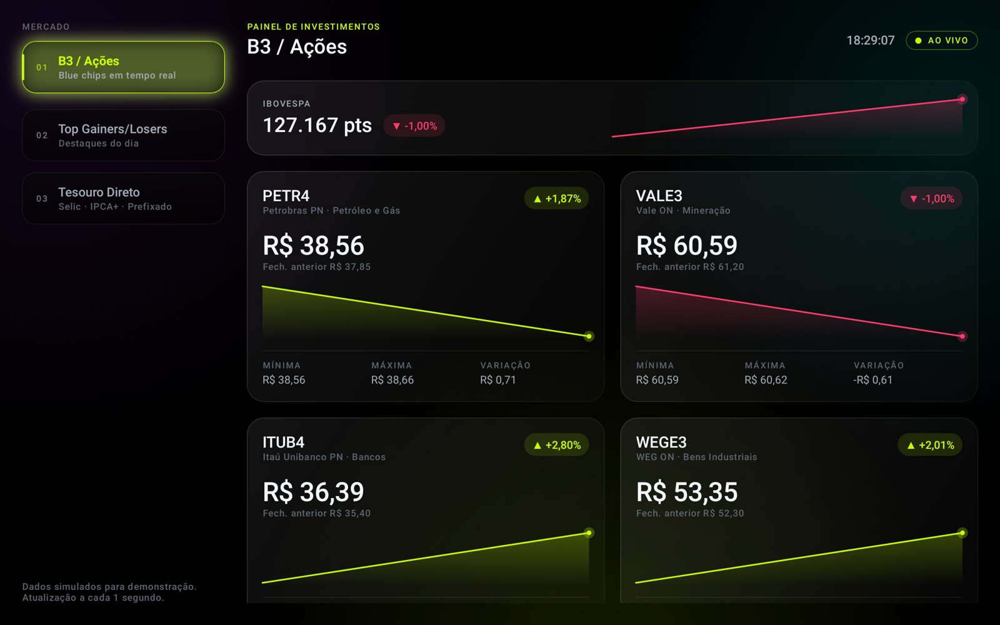
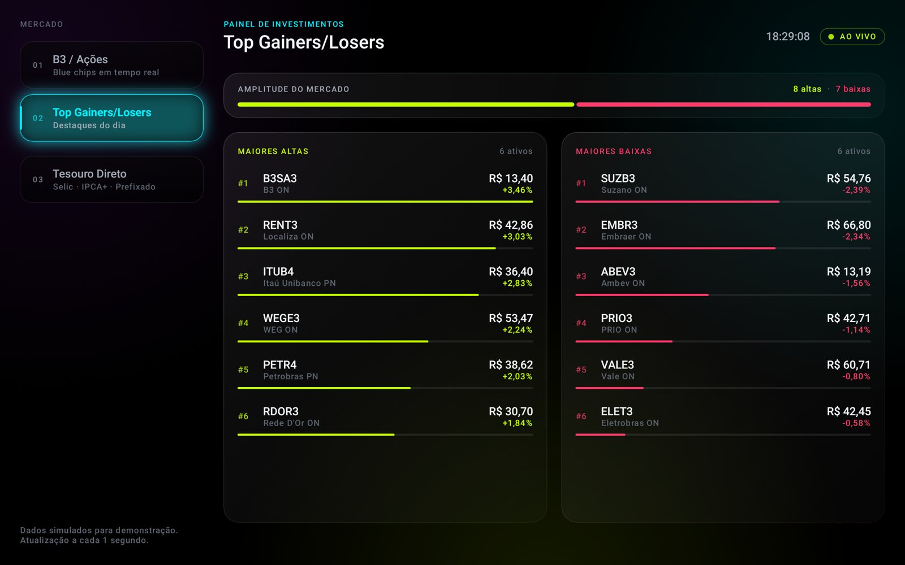
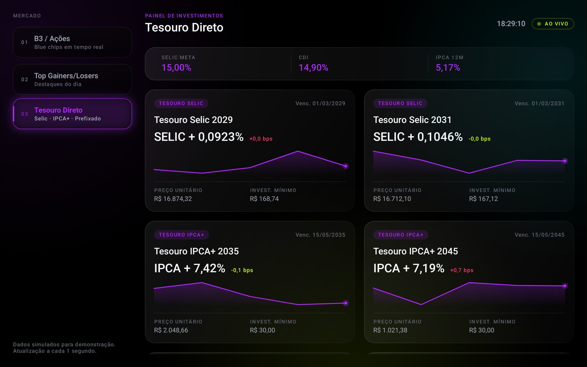

# Investimentos Neon — Painel em tempo real para tablet

App Android nativo (Kotlin + Jetpack Compose) com um painel de investimentos
em tema **Dark Neon**: fundo `#000000`, cards com glassmorphism e abas neon
(verde limão, ciano e roxo elétrico) com efeito *shuffle*.

| B3 / Ações | Top Gainers/Losers | Tesouro Direto |
|---|---|---|
|  |  |  |

> Os dados são **simulados** (`MockMarketDataSource`). Para usar dados reais,
> troque a fonte mantendo a assinatura `ticks(): Flow<MarketTick>`.

## Como rodar

Abra a pasta `android-investimentos/` no Android Studio (Ladybug ou mais novo)
e rode a configuração `app` num tablet ou emulador (ex.: *Pixel Tablet*).
Pela linha de comando:

```bash
./gradlew assembleDebug        # gera app/build/outputs/apk/debug/app-debug.apk
./gradlew installDebug         # instala no dispositivo conectado
```

Requisitos: JDK 17+, Android SDK 35. minSdk 28.

## Estrutura

```
app/src/main/java/br/com/rotina/investimentos/
├── MainActivity.kt
├── data/
│   ├── MarketModels.kt            # seeds de ações/títulos e o MarketTick
│   └── MockMarketDataSource.kt    # Flow que emite um tick a cada 1 s
└── ui/
    ├── MarketViewModel.kt         # LiveQuote / LiveBond + streamQuotes()
    ├── DashboardTab.kt            # as 3 abas e suas cores neon
    ├── theme/NeonTheme.kt         # paleta e tipografia
    ├── components/
    │   ├── NeonTabs.kt            # abas com slideUp, onda shuffle, brilho pulsante
    │   ├── Glass.kt               # GlassCard, neonGlow, fundo com halos
    │   ├── LiveValues.kt          # LiveNumber, ChangeChip, Sparkline
    │   └── Formats.kt             # formatação pt-BR
    └── screens/
        ├── InvestmentDashboardScreen.kt  # layout responsivo + LaunchedEffect
        ├── StocksPane.kt                 # PETR4, VALE3, ITUB4, WEGE3 + Ibovespa
        ├── MoversPane.kt                 # ranking de altas e baixas
        └── TreasuryPane.kt               # Selic, IPCA+ e Prefixado
```

## Como o tempo real evita recomposições desnecessárias

- **Loop de 1 s:** `InvestmentDashboardScreen` abre um `LaunchedEffect` que, via
  `repeatOnLifecycle(STARTED)`, coleta `viewModel.streamQuotes()`. O loop pausa
  quando o app vai para segundo plano e é cancelado ao sair da tela.
- **Estado granular:** cada `LiveQuote`/`LiveBond` guarda preço, taxa e
  mínima/máxima em `State`s próprios. Só os Composables pequenos que leem esses
  campos (`QuoteValue`, `QuoteChange`, `StatCell`...) recompõem a cada tick, e
  não o card ou a tela.
- **Tick atômico:** `Snapshot.withMutableSnapshot` aplica todos os preços de uma
  vez, então nenhum frame mostra metade do mercado atualizada.
- **Só desenho:** sparklines, barras do ranking, brilho neon e o piscar dos
  preços (`BasicText` com `ColorProducer`) leem o estado dentro da fase de
  desenho, então redesenham sem recompor.
- **Ranking:** `derivedStateOf(structuralEqualityPolicy())` só recompõe a lista
  quando a ordem muda; a troca de posição é animada com `Modifier.animateItem()`.

## Animações neon / shuffle

- Aba selecionada sobe 6 dp com mola (`animateDpAsState`) e muda de cor
  (`animateColorAsState`).
- Ao trocar de aba, uma onda percorre as abas em cascata (`Animatable` com
  atraso proporcional à distância).
- Uma `InfiniteTransition` compartilhada faz o brilho pulsar e alternar entre
  limão, ciano e roxo.
- O conteúdo entra com `slideInVertically` + fade (`AnimatedContent`); preços
  sobem ou descem conforme a direção e piscam na cor da tendência.

## Layout responsivo

- **Tablet (≥ 600 dp):** abas laterais + conteúdo em grid de 2 colunas.
- **Celular:** abas no topo + 1 coluna.
