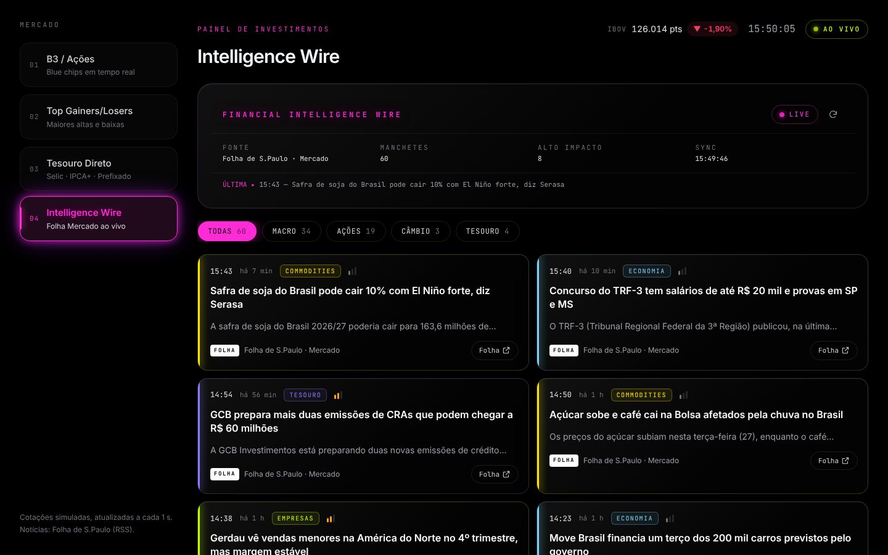
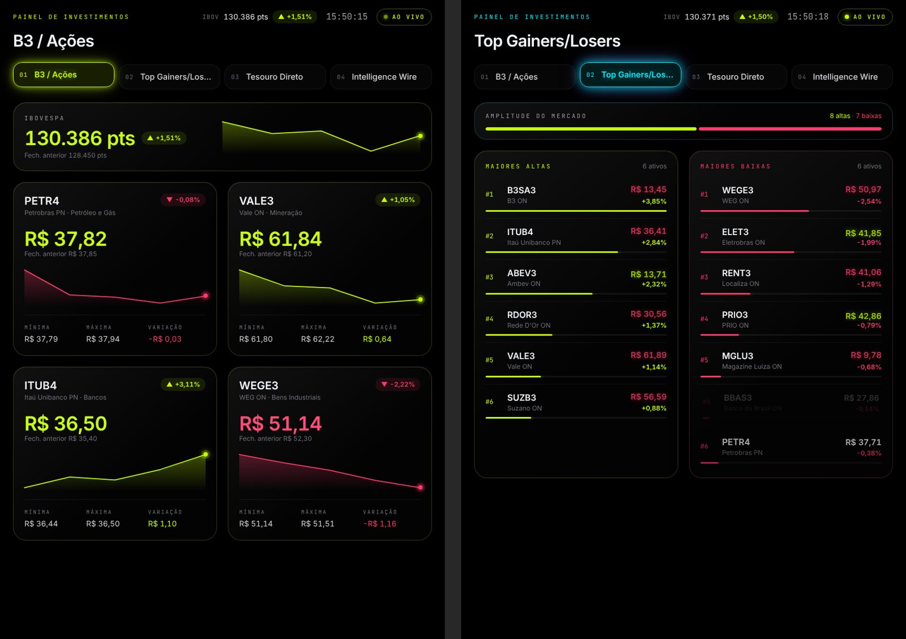

# Neon Invest · Web (Next.js PWA)

Painel de investimentos em tempo real no tema **Dark Neon Extravagant**, a
evolução web do app Android em [`../android-investimentos`](../android-investimentos).
Roda no navegador de laptop, PC, tablet e iPhone, e pode ser instalado como PWA.



| iPhone | Tablet |
|---|---|
|  |  |

## Rodando

```bash
npm install
npm run dev          # http://localhost:3000
npm run build && npm start   # produção (o service worker só registra aqui)
```

Para testar no iPhone na mesma rede: `npm run build && npx next start -H 0.0.0.0`
e abra `http://<ip-do-computador>:3000` no Safari. Para instalar como app,
abra a página pelo Safari e toque em Compartilhar → Adicionar à Tela de Início.
Isso exige HTTPS (Vercel, por exemplo) ou localhost.

Stack: Next.js 16 (App Router) · React 19 · Tailwind CSS 4 · framer-motion 12 · TypeScript.

## Módulos

| Aba | Conteúdo |
|---|---|
| **B3 / Ações** | Ibovespa + PETR4, VALE3, ITUB4, WEGE3: preço, variação, mínima/máxima, mini gráfico, tick piscando verde/vermelho |
| **Top Gainers/Losers** | Ranking de altas e baixas de 15 ações com reordenação animada (`layout`) e barra de amplitude |
| **Tesouro Direto** | Selic, IPCA+, Prefixado: taxa, variação em bps, PU, investimento mínimo + Selic Meta / CDI / IPCA 12m |
| **Intelligence Wire** | Manchetes **reais** do RSS da Folha de S.Paulo (Mercado), filtros, leitor imersivo e link direto para a matéria |

> Cotações, taxas e indicadores são **simulados**. As notícias são reais quando
> o servidor alcança o RSS da Folha; senão, o painel mostra manchetes simuladas
> com o selo "SIMULADO" (nunca atribuídas à Folha).

## Estrutura

```
src/
├── app/
│   ├── layout.tsx            # fontes, metadata PWA/iOS, viewport-fit=cover
│   ├── page.tsx
│   ├── globals.css           # design system: tokens neon, .glass, .neon-pill, ticks
│   ├── manifest.ts           # Web App Manifest
│   └── api/news/route.ts     # lê o RSS da Folha no servidor (cache de 2 min)
├── hooks/
│   ├── useMarketData.ts      # useSyncExternalStore + seletores
│   ├── useNewsFeed.ts        # polling de /api/news, marca manchetes novas
│   └── useNow.ts
├── lib/
│   ├── market/               # seeds, simulador (passeio aleatório), store de 1 s
│   ├── news/
│   │   ├── types.ts          # NewsItem, filtros, cores por categoria
│   │   ├── folha.ts          # parser do RSS (ISO-8859-1, redirecionador, entidades)
│   │   ├── classify.ts       # categoria, filtro e impacto por palavras-chave
│   │   └── mock.ts           # fallback simulado
│   ├── tabs.ts · format.ts · utils.ts
└── components/
    ├── dashboard/            # Dashboard (layout adaptativo), NeonTabs, Header
    ├── stocks/ · movers/ · treasury/
    ├── news/                 # NewsWire, NewsFilters, NewsCard, NewsReaderModal, NewsMeta
    ├── ui/                   # GlassCard, Sparkline, PriceTicker, ChangeChip, LiveBadge, Icon
    └── pwa/ServiceWorkerRegister.tsx
public/
├── sw.js                     # app shell offline + cache de assets
└── icons/
```

## Tempo real sem travar a página

- `lib/market/store.ts` roda o loop de 1 s **fora do React**. Componentes leem
  via `useMarketData(selector)` (`useSyncExternalStore`), e só quem está
  inscrito re-renderiza. Abas, títulos e layout não re-renderizam a cada tick.
- O loop só existe enquanto há inscritos e **pausa quando a aba fica oculta**,
  o que economiza bateria no iPhone.
- Cada tick é um snapshot imutável. Cards são `memo` e recebem só a própria cotação.
- O piscar dos preços é uma animação CSS de `transform`/`opacity` reiniciada
  por `key`, rodando na GPU sem JavaScript por frame.
- O estado inicial é determinístico (igual no servidor e no cliente). A
  aleatoriedade só começa no primeiro tick, então não há erro de hidratação.

## Intelligence Wire (notícias)

- `GET /api/news` busca `feeds.folha.uol.com.br/mercado/rss091.xml` no servidor
  (o RSS não tem CORS) e decodifica ISO-8859-1. Também extrai o link real de
  dentro do redirecionador e aceita apenas domínios da Folha.
- Cada manchete recebe **categoria** (Copom, Câmbio, Política Fiscal, Inflação,
  Tesouro, Empresas, Commodities, Economia), **filtro** (Macro, Ações, Câmbio,
  Tesouro) e um **indicador de impacto**. Tudo é feito por palavras-chave, é
  heurístico.
- Card: horário (BRT), tempo relativo, tag, impacto, título, resumo de 1 linha,
  selo da fonte e botão "Folha ↗" (`target="_blank" rel="noopener noreferrer"`).
- Leitor: modal no desktop e *bottom sheet* arrastável no iPhone. Esc fecha,
  ← → navega, o foco fica preso no diálogo e o scroll da página trava. Mostra
  apenas o trecho que a própria Folha publica no RSS, com o botão para a
  matéria completa.
- Atualiza a cada 90 s (só com a aba visível) e destaca manchetes novas com "NOVO".
- Sem servidor (hospedagem estática) ou sem acesso ao RSS, usa o feed simulado
  e avisa na tela.

## Layout responsivo

- **≥ 1024 px:** abas laterais + grid.
- **768–1023 px (tablet):** abas no topo + grid de 2 colunas.
- **< 768 px (iPhone):** cards empilhados + dock inferior respeitando a
  *safe area*. Os filtros rolam na horizontal sem gerar overflow na página.

> Em ambientes que exigem proxy HTTP para sair à internet, rode o servidor com
> `NODE_USE_ENV_PROXY=1` (Node 22+), senão o `fetch` do Node ignora o proxy e o
> RSS cai no modo simulado.
