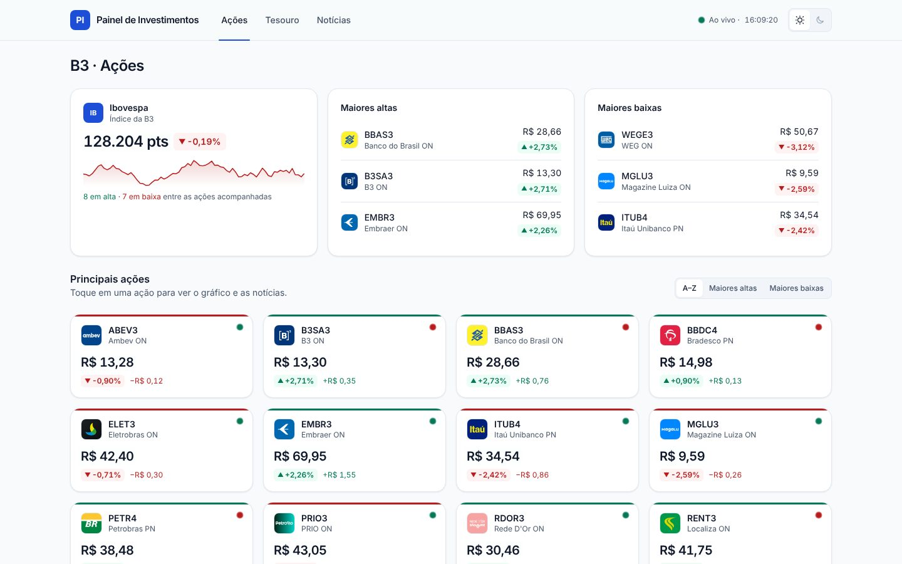
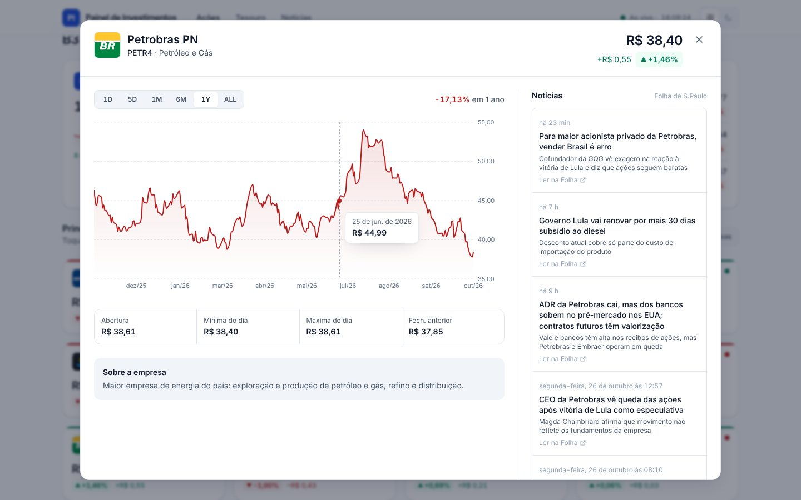
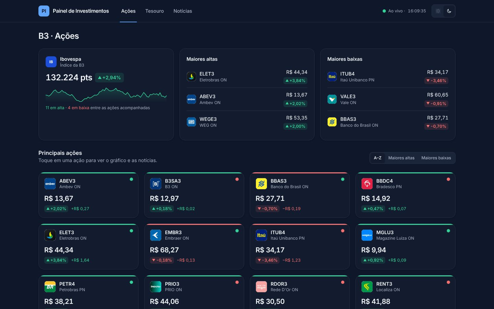
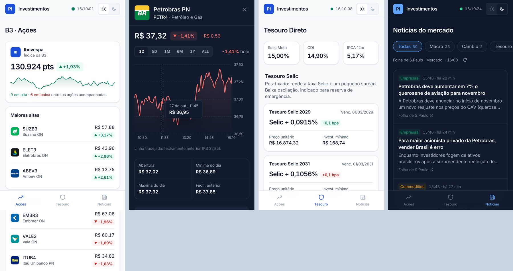

# Painel de Investimentos · Web

Painel de investimentos em tempo real com visual **clean e institucional**,
temas **claro e escuro**, e notícias da **Folha de S.Paulo**. Funciona no
navegador de qualquer laptop, PC ou celular (iPhone/Android) e pode ser
instalado como app (PWA).



| Deep-dive da ação | Tema escuro |
|---|---|
|  |  |



> **Dados:** cotações, taxas e indicadores são **simulados** (atualizados a cada
> 1 s). As **notícias são reais**: manchetes e links da Folha de S.Paulo.

---

## 🚀 Colocar no ar e ganhar um link público

Escolha **uma** das opções. As duas geram um endereço `https://...` que abre em
qualquer navegador, inclusive no celular.

### Opção A: Vercel (recomendada, ~3 minutos)

As notícias se atualizam sozinhas a cada 15 minutos, sem precisar de rebuild.

1. Acesse **https://vercel.com** e entre com sua conta do **GitHub**.
2. Clique em **Add New… → Project** e escolha o repositório **`rotina`**
   (se não aparecer, clique em *Adjust GitHub App Permissions* e libere o repositório).
3. Em **Root Directory**, clique em *Edit* e selecione **`web-investimentos`**.
   O *Framework Preset* deve ser detectado como **Next.js**. Não mude mais nada.
4. Clique em **Deploy**. Em ~1 minuto aparece o link, algo como
   `https://rotina-xxxx.vercel.app`.
5. Pronto. Cada `git push` na branch principal publica uma nova versão
   automaticamente. Outras branches ganham links de *preview*.

### Opção B: GitHub Pages (grátis, no próprio repositório)

O workflow `.github/workflows/pages.yml` já está pronto. Ele publica o app
"Rotina" na raiz e este painel em **`/investimentos`**, e republica a cada hora
para trazer notícias novas.

1. Faça o merge desta branch na **`main`** (ou rode o workflow manualmente,
   passo 3).
2. No GitHub, abra **Settings → Pages** e, em *Build and deployment*, deixe
   **Source: Deploy from a branch** com a branch **`gh-pages`** / pasta **`/ (root)`**.
3. Em **Actions → Publicar no GitHub Pages**, clique em **Run workflow**
   (pode escolher a branch) e espere ficar verde (~2 min).
4. Acesse: **`https://<seu-usuario>.github.io/rotina/investimentos/`**
   (ex.: `https://matoseb-stack.github.io/rotina/investimentos/`).

> No GitHub Pages as notícias são gravadas em arquivos estáticos a cada
> publicação. O agendamento de hora em hora mantém tudo atualizado. O GitHub
> pausa agendamentos em repositórios sem atividade há 60 dias; nesse caso, é
> só rodar o workflow de novo.

### Instalar como app no celular

- **iPhone (Safari):** abra o link → botão **Compartilhar** → **Adicionar à Tela de Início**.
- **Android (Chrome):** abra o link → menu **⋮** → **Instalar app**.

---

## Rodando localmente

```bash
cd web-investimentos
npm install
npm run dev                 # http://localhost:3000
npm run build && npm start  # produção (servidor Next, igual à Vercel)
npm run build:static        # export estático em ./out (igual ao GitHub Pages)
```

Para testar no celular na mesma rede Wi-Fi: `npx next start -H 0.0.0.0` e abra
`http://<ip-do-computador>:3000`.

Stack: Next.js 16 (App Router) · React 19 · Tailwind CSS 4 · Recharts 3 ·
framer-motion · TypeScript.

---

## O que tem no painel

### Ações (B3)
- Resumo do dia: **Ibovespa** com a curva do pregão e as **3 maiores altas e baixas**.
- **Grid de cards** das 15 principais ações (2 colunas no celular, 3 no tablet,
  4 no desktop), ordenável por A–Z, maiores altas ou maiores baixas.
- Cada card mostra logo, ticker, preço, variação, uma faixa verde/vermelha
  discreta e um ponto que **pulsa a cada atualização (1 s)**.
- **Modal deep-dive** ao clicar:
  1. **Cabeçalho:** logo, nome, ticker, preço e variação ao vivo.
  2. **Gráfico (Recharts)** com períodos `1D · 5D · 1M · 6M · 1Y · ALL`,
     tooltip, linha do fechamento anterior e variação no período.
  3. **Notícias do ativo (Folha de S.Paulo)** à direita, com título, resumo,
     horário e link direto para a matéria (`target="_blank"`).
  4. Abertura, mínima, máxima, fechamento anterior e um "Sobre a empresa".

### Tesouro Direto
Indicadores no topo (Selic Meta, CDI, IPCA 12m) e uma coluna por tipo:
**Selic**, **IPCA+** e **Prefixado**. Cada coluna explica o título em uma frase
e mostra taxa, variação em bps, preço unitário e investimento mínimo.

### Notícias
Manchetes de Mercado da Folha com filtros **Macro · Câmbio · Tesouro · Ações**.
Cada item abre a matéria original na Folha.

---

## Como funciona

### Temas claro/escuro
- Cores definidas como variáveis CSS em `src/app/globals.css` (`:root` = claro,
  `[data-theme="dark"]` = escuro) e expostas ao Tailwind via `@theme inline`
  (`bg-surface`, `text-muted`, `text-up`, `text-down`...).
- Um script inline no `<head>` aplica o tema salvo (ou o do sistema) **antes da
  primeira pintura**, sem "piscar" o tema errado. O botão ☀️/🌙 no topo alterna
  e salva a escolha.

### Tempo real
- `src/lib/market/store.ts` roda o loop de 1 s fora do React. Componentes leem
  com `useMarketData(seletor)` (`useSyncExternalStore`), então só quem usa o
  dado re-renderiza. O loop pausa quando a aba fica oculta.
- O gráfico usa uma série histórica simulada **determinística por ativo**
  (`src/lib/market/history.ts`). O desenho é estável e o último ponto segue o
  preço ao vivo.

### Notícias da Folha
| Arquivo gerado | Origem |
|---|---|
| `/api/news.json` | RSS de Mercado da Folha (`feeds.folha.uol.com.br/mercado/rss091.xml`) |
| `/api/asset-news/<TICKER>.json` | Página de tópico da empresa na Folha (ex.: `/folha-topicos/petrobras/`) ou a busca da Folha, filtrada para seções de negócios que citam a empresa |

- Os dois são *Route Handlers* estáticos: viram arquivos JSON no build
  (GitHub Pages) e são revalidados a cada 15 min no servidor (Vercel).
- Só links de domínios da Folha são aceitos. Se o RSS geral falhar, a aba de
  notícias mostra manchetes **simuladas** com o selo "Simulado", nunca
  atribuídas à Folha. As notícias por ativo não têm conteúdo simulado: sem
  resultado, o modal oferece o link para a página da empresa na Folha.
- Logos das empresas: ícones públicos da [brapi.dev](https://brapi.dev),
  com monograma na cor da marca como reserva.

### Estrutura

```
src/
├── app/
│   ├── layout.tsx                    # fonte, PWA, script de tema
│   ├── globals.css                   # design system (tokens claro/escuro)
│   ├── manifest.ts
│   └── api/
│       ├── news.json/route.ts        # notícias gerais (Folha · Mercado)
│       └── asset-news/[file]/route.ts# notícias por ativo
├── components/
│   ├── layout/      AppHeader · BottomNav
│   ├── theme/       ThemeToggle
│   ├── stocks/      StocksPanel · StockCard · StockModal · StockChart · AssetNews
│   ├── treasury/    TreasuryPanel
│   ├── news/        NewsPanel
│   └── ui/          StockLogo · LivePrice/TickDot · ChangeChip · Sparkline · Icon
├── hooks/           useMarketData · useNewsFeed · useAssetNews · useNow
└── lib/
    ├── market/      seeds · simulator · store · history
    ├── news/        folha · companies · company-sources · classify · mock · types
    ├── theme.ts · base-path.ts · format.ts · tabs.ts
```

> Em ambientes que exigem proxy HTTP para sair à internet, rode o build com
> `NODE_USE_ENV_PROXY=1` (Node 22+). Sem isso, o `fetch` do Node ignora o
> proxy e as notícias caem no modo simulado.
