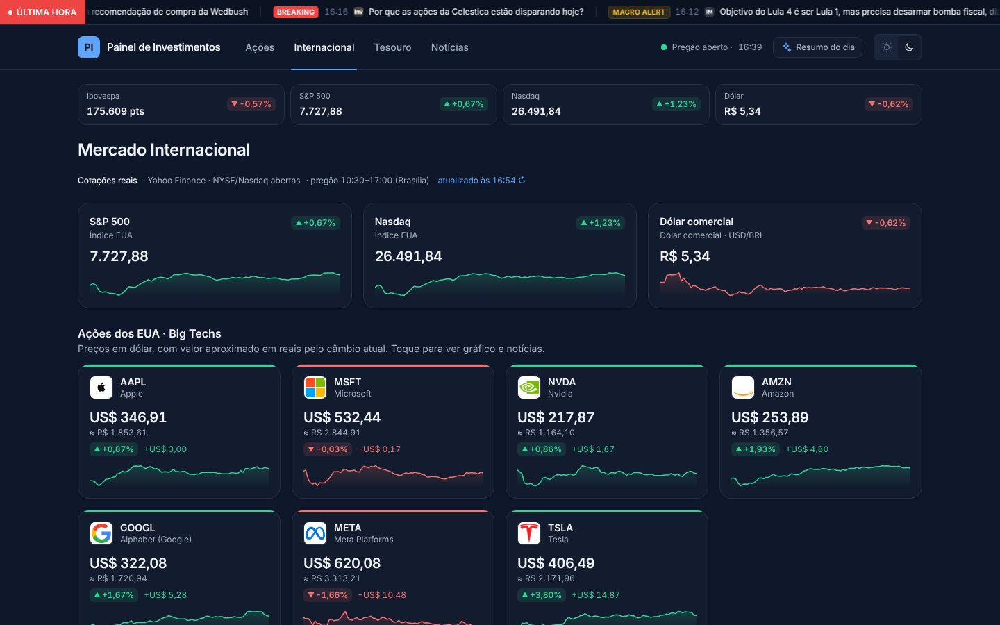
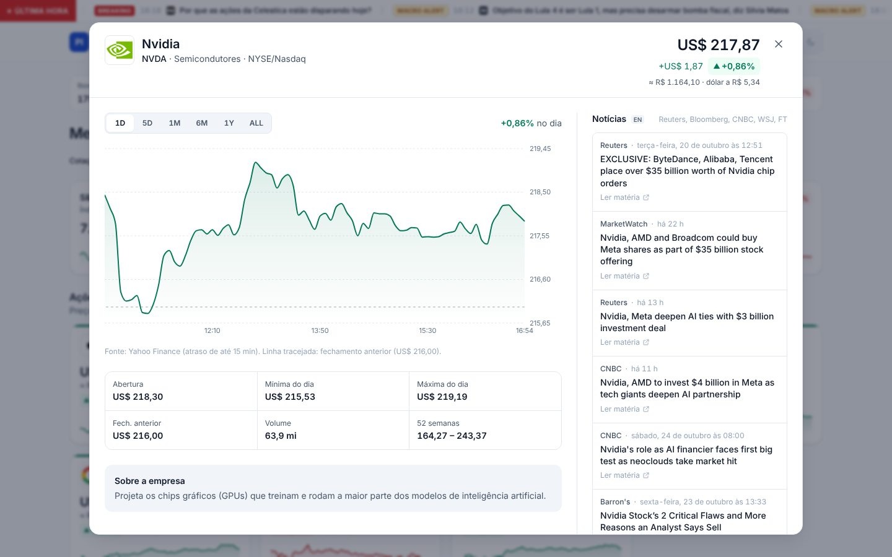
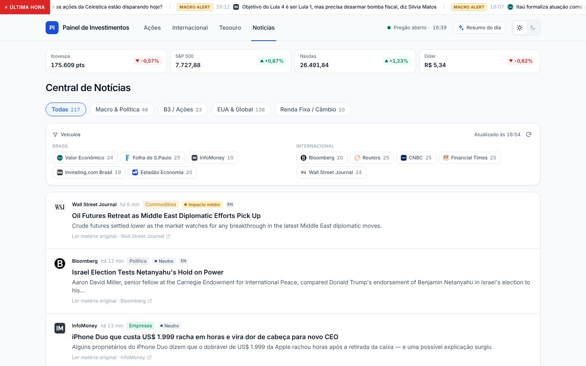
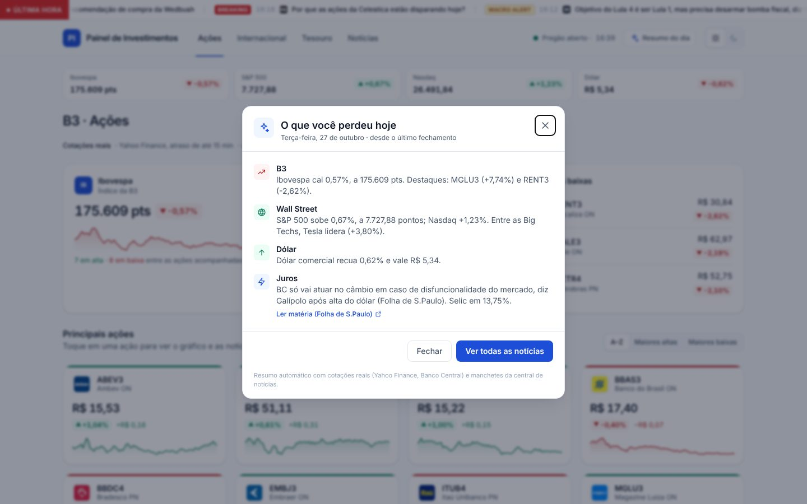

# Painel de Investimentos · Web

**🔗 Link público: https://matoseb-stack.github.io/rotina/investimentos/**

Painel de investimentos com **cotações e gráficos reais** da B3 e de Wall Street,
**central de notícias com 10 veículos** (Brasil e internacional), **faixa de
última hora** e **resumo "O que você perdeu hoje"**. Visual clean e
institucional, com temas **claro e escuro**. Funciona no navegador de qualquer
laptop, PC ou celular e pode ser instalado como app (PWA).


| Internacional (tema escuro) | Deep-dive de ação americana |
|---|---|
|  |  |

| Central de notícias | O que você perdeu hoje |
|---|---|
|  |  |


## De onde vêm os dados

| O quê | Fonte | Atualização |
|---|---|---|
| Ações da B3, Ibovespa | Yahoo Finance (atraso de até 15 min) | 60 s na Vercel · 15 min no GitHub Pages durante o pregão |
| Ações e ETFs dos EUA, S&P 500, Nasdaq | Yahoo Finance | idem |
| Dólar comercial (USD/BRL) | Yahoo Finance (`BRL=X`) | idem |
| Gráficos 1D · 5D · 1M · 6M · 1Y · ALL | Yahoo Finance (histórico real) | 5 min na Vercel · 15 min no Pages |
| Selic Meta, CDI, IPCA 12m | Banco Central (SGS 432, 4389, 13522) | 1 h |
| Notícias gerais | Valor, Folha, InfoMoney, Investing.com Brasil, Estadão, Bloomberg, Reuters, CNBC, FT, WSJ | 15 min na Vercel · 1 h no Pages |
| Notícias por ação (B3) | Folha de S.Paulo (página do tópico ou busca) | idem |
| Notícias por ação (EUA) | Reuters, Bloomberg, CNBC, WSJ, FT, MarketWatch, Barron's (via Google News, em inglês) | idem |
| Taxas dos títulos do Tesouro | **simuladas** (o Tesouro desativou a API pública) | 1 s |

> **Por que não há "tick" de 1 segundo nos preços?** Cotações reais gratuitas
> não mudam a cada segundo (a B3 chega com até 15 min de atraso). Em vez de
> inventar oscilações em cima de dados reais, o painel recarrega as cotações a
> cada 60 s e destaca cada mudança com um realce discreto. Só as taxas do
> Tesouro, que já são simuladas, andam a cada segundo.

Sobre os veículos:
- **Reuters** encerrou seus feeds RSS; as manchetes vêm da busca do Google
  News (`site:reuters.com`) e o link abre a matéria na Reuters.
- **CNBC** bloqueia alguns servidores; quando isso acontece, cai no mesmo
  caminho do Google News.
- **Broadcast (Estadão)** é exclusivo para assinantes do terminal; usamos o
  feed público de **Estadão Economia**.
- Se nenhum veículo responder, o painel mostra manchetes **simuladas**, com
  selo "Simulado", nunca atribuídas a um veículo real.

---

## O que tem no painel

### Topo fixo
- **Faixa de última hora:** manchetes de alto impacto e macro de todos os
  veículos, deslizando continuamente.
  - Selo vermelho **BREAKING** para alto impacto nas últimas 2 h.
  - Selo amarelo **MACRO ALERT** para Copom, Fed, inflação e fiscal.
  - Pausa ao passar o mouse ou focar, e vira rolagem manual com "reduzir movimento".
- **"O que você perdeu hoje":** abre sozinho na primeira visita do dia e pelo
  botão **Resumo do dia**. Traz 4 tópicos montados com números reais:
  Ibovespa e destaques da B3, S&P 500/Nasdaq e a Big Tech que lidera, dólar,
  e a manchete mais recente de Copom/Fed com a Selic atual.
- **Faixa de mercado:** Ibovespa, S&P 500, Nasdaq e dólar.

### Ações (B3)
Grid com as 15 principais ações, maiores altas e baixas, e um modal com
gráfico real, estatísticas do dia e notícias da Folha.

### Internacional (novo)
- **Big Techs:** AAPL, MSFT, NVDA, AMZN, GOOGL, META, TSLA.
- **ETFs globais:** SPY, QQQ, DIA, VOO, IVV, BND.
- Cada card mostra logo, preço em **US$**, variação e o valor **aproximado em
  R$** pelo dólar do momento.
- O modal tem gráfico real, estatísticas e notícias da imprensa global
  (em inglês, com o nome de cada veículo).

### Tesouro Direto
Selic, IPCA+ e Prefixado por coluna, com Selic/CDI/IPCA reais no topo.

### Central de Notícias
- **Filtros por tema:** Todas · Macro & Política · B3 / Ações · EUA & Global ·
  Renda Fixa / Câmbio.
- **Filtro por veículo:** selos com o ícone oficial de cada site, separados em
  Brasil e Internacional.
- **Cards:** veículo, "há X min", categoria, **nível de impacto** (alto,
  médio ou neutro, por palavras-chave da manchete) e link para a matéria
  original em nova aba.

---

## 🚀 Publicar e manter o link no ar

### GitHub Pages (já configurado)
O workflow `.github/workflows/investimentos.yml`:
- gera o site estático **já com cotações, gráficos e notícias do momento**;
- publica **só** a pasta `/investimentos` na branch `gh-pages`, sem tocar no
  app Rotina da raiz.

Dicas para manter tudo rodando:
1. **Faça o merge na `main`.** O GitHub só roda agendamentos (`schedule`) na
   branch padrão. Com o merge, o painel se republica a cada 15 min no pregão
   (B3 e NYSE) e de hora em hora fora dele.
2. **O workflow da raiz apaga `/investimentos`** ao publicar o app Rotina
   (`force_orphan`). Depois do merge, o gatilho `workflow_run` republica o
   painel logo em seguida.
3. **Republicar na hora:** Actions → *Publicar Painel de Investimentos* → *Run workflow*.
4. **Conferir se os dados são reais:** o passo *Conferir se as cotações vieram
   da fonte real* imprime `fonte: yahoo` no log. Se aparecer `simulado`, o
   Yahoo bloqueou aquele build; o próximo agendamento normalmente resolve.
5. O GitHub pausa agendamentos em repositórios sem atividade há 60 dias:
   basta rodar o workflow de novo.
6. Em outro repositório/fork: **Settings → Pages → Deploy from a branch →
   `gh-pages` / `(root)`**. O endereço fica
   `https://<usuario>.github.io/<repositorio>/investimentos/`.

### Vercel (cotações a cada minuto)
1. Em **vercel.com**, entre com o GitHub e clique em **Add New… → Project → `rotina`**.
2. Em **Root Directory**, escolha **`web-investimentos`** (Next.js é detectado sozinho).
3. Clique em **Deploy**.

Na Vercel o servidor revalida cotações a cada 60 s, gráficos a cada 5 min e
notícias a cada 15 min, sem rebuild. Não defina `STATIC_EXPORT` lá.

### Instalar como app no celular
- **iPhone (Safari):** Compartilhar → **Adicionar à Tela de Início**.
- **Android (Chrome):** menu ⋮ → **Instalar app**.

---

## Rodando localmente

```bash
cd web-investimentos
npm install
npm run dev                 # http://localhost:3000
npm run build && npm start  # produção com servidor (igual à Vercel)
npm run build:static        # export estático em ./out (igual ao GitHub Pages)
```

Em redes que exigem proxy HTTP, rode com `NODE_USE_ENV_PROXY=1` (Node 22+).
Sem isso, o `fetch` do Node ignora o proxy e cotações e notícias caem no modo
de reserva.

Stack: Next.js 16 (App Router) · React 19 · Tailwind CSS 4 · Recharts 3 ·
framer-motion · TypeScript.

## Como funciona por dentro

- **Dados no servidor/build:** os *Route Handlers* em `src/app/api/` são
  estáticos (`force-static` + `revalidate`). No GitHub Pages viram arquivos
  JSON no build; na Vercel são revalidados no servidor. O navegador nunca
  chama Yahoo ou os veículos direto (sem CORS).

  | Rota | Conteúdo |
  |---|---|
  | `/api/market/quotes.json` | B3, EUA, ETFs, índices, dólar e macro do BCB |
  | `/api/market/history/<TICKER>.json` | as 6 séries do gráfico |
  | `/api/news.json` | central com os 10 veículos, sem duplicatas |
  | `/api/asset-news/<TICKER>.json` | notícias do ativo |

- **Estado no cliente:** três *stores* externos (`useSyncExternalStore`):
  - cotações reais, recarregadas a cada 60 s;
  - notícias, a cada 5 min, num único fetch compartilhado pela faixa de última
    hora, pelo resumo e pela aba de notícias;
  - Tesouro simulado, a 1 s.

  Os seletores fazem cada componente re-renderizar só quando o seu dado muda.
  Os stores pausam com a aba oculta.
- **Faixa de última hora leve:** animação só de `transform` (GPU), duas cópias
  do trilho para o loop sem salto e nenhum re-render por tick de preço.
- **Temas:** tokens CSS em `globals.css` (`:root` claro, `[data-theme="dark"]`
  escuro), inclusive `--ticker-bg`, `--breaking` e `--warn` da faixa de última
  hora. O gráfico (SVG do Recharts) recebe as cores do tema em JS.

```
src/
├── app/api/        market/quotes.json · market/history/[file] · news.json · asset-news/[file]
├── components/
│   ├── layout/       BreakingNewsBar · AppHeader · MarketStrip · BottomNav
│   ├── briefing/     MissedTodayModal
│   ├── stocks/       StocksPanel · StockCard · StockModal · StockChart · AssetNews
│   ├── international/InternationalPanel
│   ├── treasury/     TreasuryPanel
│   ├── news/         NewsPanel · SourceSeal · ImpactBadge
│   └── ui/           StockLogo · LivePrice · ChangeChip · Sparkline · Icon
├── hooks/          useMarketData · useNewsFeed · useStockHistory · useAssetNews · useNow
└── lib/
    ├── market/       real/ (Yahoo, BCB) · seeds · store · logos · simulator
    ├── news/         sources · aggregate · rss · classify · companies · global-assets · store
    ├── briefing.ts   resumo "O que você perdeu"
    └── theme.ts · format.ts · tabs.ts · base-path.ts
```
